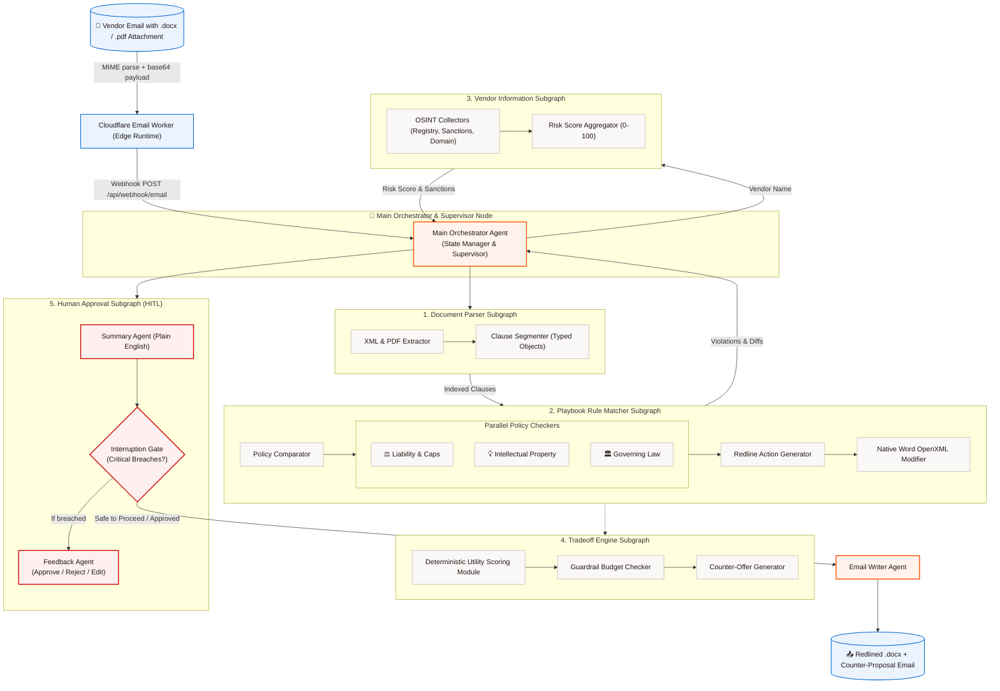

# RedLiner ✍️⚡
### Autonomous B2B Contract Negotiation & Legal Redlining Multi-Agent System

> **Academic Project Synopsis:** Group 8 | CSE 1  
> **Team Members:** Divyam Joshi (230452), Amrit Parashar (230453), Siddharth Jain (230482), Manit Trehan (230489)  
> **Current Milestone:** 40%–50% Core Architecture Implementation  
> **GitHub Repository:** [https://github.com/DivyamJoshi2005/RedLiner.git](https://github.com/DivyamJoshi2005/RedLiner.git)

---


## 📖 Table of Contents
1. [Executive Summary & The Problem](#-executive-summary--the-problem)
2. [What Makes RedLiner an "Agentic AI" System?](#-what-makes-redliner-an-agentic-ai-system)
3. [System Architecture & Agent Topology](#-system-architecture--agent-topology)
4. [Step-by-Step Working Walkthrough](#-step-by-step-working-walkthrough)
5. [The Agents & Subgraphs Explained](#-the-agents--subgraphs-explained)
6. [Mathematical Scoring & Risk Evaluation Mechanisms](#-mathematical-scoring--risk-evaluation-mechanisms)
7. [Why Native Word OpenXML Tracked Changes Matter](#-why-native-word-openxml-tracked-changes-matter)
8. [Repository Structure & Clean Directory Design](#-repository-structure--clean-directory-design)
9. [Current Implementation vs. Future Roadmap](#-current-implementation-vs-future-roadmap)
10. [How to Run, Test, and Verify](#-how-to-run-test-and-verify)
11. [REST API Reference](#-rest-api-reference)
12. [Design Philosophy: Zapier-Inspired Clean UI](#-design-philosophy-zapier-inspired-clean-ui)

---

## 📌 Executive Summary & The Problem

In enterprise B2B sales and procurement, closing a deal requires agreeing on contracts (Master Services Agreements, Statements of Work, Service Level Agreements). However, contract negotiations are notoriously slow and painful:

* ⏱️ **Average Execution Time:** A standard B2B contract takes **3.4 weeks** to close.
* ⏳ **Legal Bottlenecks:** Each manual review and redlining cycle takes **5 to 10 business days** per round.
* 📄 **Manual Dominance:** **71% of organizations** still rely on completely manual contract review processes (World Commerce & Contracting).
* 💸 **Value Erosion:** Organizations experience an average contract value loss of **8.6%** during prolonged, contentious negotiations due to concessions made without quantitative risk assessment.

### The RedLiner Solution
**RedLiner** is an autonomous, cyclic multi-agent system designed for procurement managers, in-house legal counsel, and finance leaders. 

Instead of waiting days for a lawyer to manually review repetitive boilerplate terms, RedLiner:
1. **Ingests vendor contract attachments (`.docx` and `.pdf`) automatically via inbound email webhooks**.
2. **Parses and indexes every contract clause** into typed semantic objects (`LIABILITY_CAP`, `IP_RIGHTS`, `PAYMENT_TERMS`, etc.).
3. **Executes parallel policy audits** against corporate playbooks.
4. **Performs live OSINT due diligence and sanctions screening** on the vendor counterparty.
5. **Generates native Microsoft Word documents** with real, trackable OpenXML changes (`<w:del>`, `<w:ins>`) and margin comment bubbles (`<w:comment>`).
6. **Determines financial & legal trade-offs** using deterministic utility models (e.g., offering a 5% price bump in exchange for extending payment terms to Net 60).
7. **Pauses for Human-in-the-Loop (HITL) approval** if critical liabilities or sanctioned entities are detected.
8. **Drafts and dispatches structured counter-proposal emails** directly back to the vendor.

---

## 🤖 What Makes RedLiner an "Agentic AI" System?


```
┌─────────────────────────────────────────────────────────────────────────────┐
│                       WHAT MAKES REDLINER AGENTIC?                          │
├─────────────────────────────────────────────────────────────────────────────┤
│ 1. Event-Driven Perception  │ Inbound email triggers the workflow           │
│ 2. Supervisor-Worker Pattern│ Main Orchestrator manages state & delegation │
│ 3. Cognitive Subgraphs      │ Specialized units solve domain tasks          │
│ 4. Parallel Reasoning       │ Concurrent policy audits (Liability, IP, Law) │
│ 5. Tool / Environment Use   │ Native Word OpenXML editing & OSINT database  │
│ 6. Deterministic Guardrails │ Mathematical utility scoring prevents hallucination │
│ 7. Human-in-the-Loop (HITL) │ Autonomous until risky — pauses for approval  │
│ 8. Cyclic Convergence Loop  │ Re-evaluates counter-offers across iterations │
└─────────────────────────────────────────────────────────────────────────────┘
```

1. **Goal-Directed Autonomy:**  
   Standard AI answers prompts; RedLiner has an active goal: *"Negotiate this vendor contract to full alignment with our corporate playbook while maximizing financial deal value and minimizing legal exposure."*

2. **Hierarchical Supervisor Pattern:**  
   The **Main Orchestrator** functions as a supervisor node. It monitors the global state, delegates tasks to specialized subgraphs, verifies convergence, and determines whether human intervention is required.

3. **Cognitive Subgraphs as Specialized Teams:**  
   Instead of asking one monolithic prompt to "review this contract", RedLiner divides the cognitive load into isolated subgraphs: one extracts structure, one checks legal compliance, one performs external due diligence, one computes commercial trade-offs, and one manages human oversight.

4. **Multi-Agent Parallelism:**  
   In legal reviews, different clauses can be analyzed concurrently. RedLiner executes parallel policy checks across **Liability & Compensation**, **Intellectual Property**, and **Governing Law** simultaneously, cutting iteration latency from minutes to milliseconds.

5. **Direct Artifact Manipulation (Tool Use):**  
   Agents don't just output text suggestions. RedLiner interacts directly with the software environment by manipulating the underlying OpenXML architecture of `.docx` files, injecting native `<w:del>` strikethroughs, `<w:ins>` insertions, and `<w:comment>` review bubbles that standard Microsoft Word can open.

6. **Deterministic Math Guardrails (No Hallucinated Deals):**  
   LLMs are prone to arithmetic errors and hallucinated compromises. RedLiner bounds commercial negotiations using a deterministic **Utility Function** and hard budget guardrails. An agent cannot promise terms that violate company policy.

7. **Human-in-the-Loop (HITL) Safety Gates:**  
   The system operates autonomously within safe tolerances. When an agent detects a deal-breaker (e.g., uncapped indemnification or a sanctioned vendor), it triggers an **Interruption Gate**, freezing the state and requesting approval on the dashboard.

---

## 🏗️ System Architecture & Agent Topology

The RedLiner architecture strictly follows Section 5 of the project synopsis (`AG_AI_Project_Synopsis_Grp_8.pdf`):



---

## 🚶 Step-by-Step Working Walkthrough

Here is the exact lifecycle of a contract negotiation in RedLiner:

```
[Vendor Email] ➔ [Parse & Segment] ➔ [Parallel Audit & OSINT] ➔ [OpenXML Redline] ➔ [HITL Safety Check] ➔ [Counter Email]
```

### Step 1: Inbound Vendor Email Webhook
1. A vendor emails a proposal (e.g., `vendor_saas_agreement.docx` or `.pdf`) to `deals@redliner.org`.
2. The **Cloudflare Email Routing Worker** intercepts the incoming email at the edge.
3. Using `postal-mime`, the worker parses the RFC 822 email, extracts file attachments, converts them to base64, and fires an authenticated HTTP POST webhook to RedLiner's `/api/webhook/email`.

### Step 2: Document Parsing & Clause Classification
1. The **Document Parser Subgraph** receives the file.
2. If it's a `.docx`, the `xml_extractor.py` parses the document's paragraph tree. If it's a `.pdf`, `pdf_extractor.py` extracts digital text blocks.
3. The `clause_segmenter.py` uses heuristic pattern matching and NLP classification to tag each paragraph with a domain type:
   * `LIABILITY_CAP`, `INDEMNIFICATION`, `IP_RIGHTS`, `GOVERNING_LAW`, `PAYMENT_TERMS`, `TERMINATION`, `DATA_PRIVACY_SECURITY`, etc.
4. Each clause is indexed with its paragraph number, confidence score, and original text.

### Step 3: Parallel Policy Audit & Vendor Intelligence
1. The **Main Orchestrator** initiates two tasks concurrently:
   * **Task A: Vendor Intelligence Subgraph:** Queries the SQLite intelligence database (`52` enterprise vendor records) and simulates OSINT queries (OFAC sanctions, PEP screening, corporate registries, domain age). It calculates a standardized **Risk Score (0–100)** and assigns a risk tier (`LOW`, `MEDIUM`, `HIGH`, `CRITICAL`).
   * **Task B: Playbook Matcher Subgraph:** Loads corporate legal rules from `playbooks/enterprise_playbook.yaml`. It distributes clauses across three parallel checkers:
     * *Liability & Indemnification Checker:* Flags uncapped liability, one-sided indemnities, or caps exceeding 12 months' fees.
     * *Intellectual Property Checker:* Flags vendor retention of buyer data, derivative work ownership, or missing perpetual licenses.
     * *Governing Law Checker:* Flags foreign or unfavorable jurisdictions (e.g., rejecting foreign courts in favor of Delaware/New York law).

### Step 4: Native Word OpenXML Modification
1. For every policy violation, the `redline_action_generator.py` produces an exact replacement with rationale.
2. The `word_modifier.py` opens the source `.docx` as an OpenXML package.
3. Rather than outputting simple markdown diffs, it creates native Word XML nodes:
   * Wraps rejected vendor text in `<w:del>` elements (red strikethrough).
   * Wraps approved corporate fallback text in `<w:ins>` elements (underlined text).
   * Injects `<w:commentRangeStart>`, `<w:commentRangeEnd>`, and `<w:commentReference>` tags tied to a newly provisioned `word/comments.xml` document part.
4. The resulting `.docx` file contains native Word tracked changes that legal counsel can open, accept, or reject in Microsoft Word.

### Step 5: Financial Trade-Off Modeling
1. The **Tradeoff Engine Subgraph** evaluates commercial terms.
2. If the vendor proposed aggressive payment terms (e.g., Net 30 with upfront annual payment), the `math_engine.py` calculates a **Normalized Utility Score**:
   $$\text{Utility} = w_{\text{cost}} \cdot \text{CostEfficiency} + w_{\text{terms}} \cdot \text{TermScore} - w_{\text{risk}} \cdot \text{RiskPenalty}$$
3. The `tradeoff_generator.py` crafts counter-offers (e.g., offering a 5% unit price increase in exchange for shifting from Net 30 to Net 60).
4. The `guardrail_checker.py` guarantees the counter-offer never exceeds pre-set budget caps.

### Step 6: Human-in-the-Loop (HITL) Gate
1. The **Summary Agent** compiles an executive summary in plain English.
2. The **Interruption Gate** checks:
   * Are there $\ge 1$ CRITICAL legal violations (e.g., unlimited liability)?
   * Is the vendor risk score $\ge 70$ (or flagged for sanctions)?
3. If **YES**, execution immediately pauses. The deal is marked `requires_human_approval = True` and sent to the dashboard.
4. Counsel reviews the plain-English summary, examines the redline preview, and selects:
   * **Approve:** Releases the deal to dispatch the counter-proposal.
   * **Reject:** Terminates negotiation and drafts a rejection email.
   * **Manual Edit:** Allows counsel to tweak specific clauses before continuing.

### Step 7: Email Writer & Outbound Dispatch
1. The **Email Writer Agent** synthesizes the redline results, commercial trade-offs, and legal justifications into a professional, collaborative email.
2. It attaches the native redlined `.docx` contract.
3. The email is dispatched through Cloudflare Email Routing / Resend back to the vendor counterparty.

---

## 👥 The Agents & Subgraphs Explained

The codebase is organized into modular agents and subgraphs matching the synopsis specifications:

| Agent / Subgraph | Location | Role in the System |
| :--- | :--- | :--- |
| **Main Orchestrator** | `agents/orchestrator.py` | Supervisor node. Manages state checkpoints, coordinates subgraphs, checks convergence, and triggers human approval gates. |
| **Procurement Negotiator** | `agents/procurement_negotiator.py` | Evaluates pricing tiers, volume discounts, and service-level agreements (SLAs). Plans commercial concessions. |
| **Legal Redliner** | `agents/legal_redliner.py` | Corporate playbook enforcement agent. Generates clause modifications and coordinates the playbook matcher. |
| **Finance, Compliance & Risk** | `agents/finance_compliance_risk.py` | Commercial boundary checker. Verifies budget limits and evaluates payment terms (Net 30 vs. Net 60). |
| **Vendor Intelligence** | `agents/vendor_intelligence.py` | Conducts counterparty due diligence, sanction screening, and credit risk evaluation. |
| **Email Writer** | `agents/email_writer.py` | Composes contextual, professional counter-proposal emails with redline attachments. |
| **Document Parser Subgraph** | `subgraphs/document_parser/` | Ingests `.docx` OpenXML and digital `.pdf` contracts, segmenting paragraphs into typed `Clause` objects. |
| **Playbook Matcher Subgraph** | `subgraphs/playbook_matcher/` | Runs parallel policy audits and modifies native OpenXML to create tracked changes and comments. |
| **Tradeoff Engine Subgraph** | `subgraphs/tradeoff_engine/` | Deterministic utility calculation engine that crafts mathematically bounded counter-proposals. |
| **Vendor Info Subgraph** | `subgraphs/vendor_information/` | OSINT data collectors, OFAC/PEP screening, and standardized risk score aggregation. |
| **Human Approval Subgraph** | `subgraphs/human_approval/` | Summarizes deal exposure, enforces the interruption gate, and handles human decisions (HITL). |

---

## 🧮 Mathematical Scoring & Risk Evaluation Mechanisms

To avoid relying on unstructured Large Language Model text completions for high-stakes financial and legal determinations, RedLiner implements **two deterministic, reproducible scoring mechanisms** running in Python:

```
┌────────────────────────────────────────────────────────────────────────────────────────┐
│                        REDLINER DETERMINISTIC SCORING ENGINES                          │
├────────────────────────────────────────────────────────────────────────────────────────┤
│ 1. Normalized Deal Utility Score (0.0 to 1.0) │ Balances Price, Terms & Risk Penalties │
│ 2. Multi-Factor Vendor Risk Score (0 to 100)  │ OFAC Sanctions, Credit, Litigation, OSINT │
└────────────────────────────────────────────────────────────────────────────────────────┘
```

---

### Mechanism 1: Normalized Deal Utility Score ($U$)
* **Location:** [`subgraphs/tradeoff_engine/math_engine.py`](file:///home/Divyam/Desktop/Skills/Projects/RedLiner/subgraphs/tradeoff_engine/math_engine.py) (`PythonMathEngine.calculate_utility`)
* **Role:** Evaluates whether a proposed counter-offer represents an acceptable commercial deal for the buyer on a standardized scale from **0.0 (Worst)** to **1.0 (Optimal)**.

#### Mathematical Formulation:
$$U = \max\left(0.0, \, \min\left(1.0, \, U_{\text{price}} + U_{\text{terms}} - P_{\text{risk}}\right)\right)$$

#### Component Breakdown:

1. **Price Utility Component ($50\%$ Weight):**
   $$U_{\text{price}} = \min\left(1.0, \, \frac{\text{Target Price}}{\max(\text{Offered Unit Price}, 1.0)}\right) \times 0.5$$
   * If the vendor's price is at or below target, this term yields the maximum **$0.50$**.
   * If the offered price exceeds our target, the utility scales down proportionally.

2. **Payment Terms Utility Component ($30\%$ Weight):**
   $$U_{\text{terms}} = \left(\frac{\min(\text{Payment Days}, 60)}{60.0}\right) \times 0.3$$
   * **Net 60 Days:** $(60/60) \times 0.3 = \mathbf{0.30}$ *(Full enterprise cash flow preservation)*
   * **Net 45 Days:** $(45/60) \times 0.3 = \mathbf{0.225}$
   * **Net 30 Days:** $(30/60) \times 0.3 = \mathbf{0.150}$
   * **Net 15 Days:** $(15/60) \times 0.3 = \mathbf{0.075}$

3. **Vendor Risk Penalty Deduction ($20\%$ Weight):**
   $$P_{\text{risk}} = \left(\frac{\min(\text{Vendor Risk Score}, 100.0)}{100.0}\right) \times 0.2$$
   * A high vendor risk score directly erodes deal utility. For example, a counterparty with a Risk Score of **$50.0/100$** triggers an automatic penalty deduction of:
     $$\left(\frac{50.0}{100.0}\right) \times 0.2 = \mathbf{-0.10}$$

#### Guardrails & Boundary Verification:
Implemented in [`subgraphs/tradeoff_engine/guardrail_checker.py`](file:///home/Divyam/Desktop/Skills/Projects/RedLiner/subgraphs/tradeoff_engine/guardrail_checker.py):
* **Minimum Acceptable Utility:** Any deal producing $U < 0.55$ fails the guardrail check.
* **Hard Budget Cap:** Deals where $\text{Deal Cost} > \$150,000$ trigger an automatic hard stop.
* **Non-Negotiables:** Core intellectual property ownership and data privacy guardrails have an infinite implicit weight; agents cannot concede client IP for commercial discounts under any circumstances.

---

### Mechanism 2: Multi-Factor Vendor Risk Score (0 to 100)
* **Location:** [`subgraphs/vendor_information/score_aggregator.py`](file:///home/Divyam/Desktop/Skills/Projects/RedLiner/subgraphs/vendor_information/score_aggregator.py) (`ScoreAggregator.calculate_score`)
* **Role:** Quantifies counterparty credit exposure, corporate registration legitimacy, litigation history, and international sanctions compliance before any contract is redlined or executed.

#### Mathematical Formulation:
$$\text{Final Risk Score} = \max\left(0.0, \, \min\left(100.0, \, \sum \text{Risk Penalties} - \sum \text{Security Credits}\right)\right)$$

#### Step-by-Step Scoring Rules:

1. **Immediate Sanctions Check (OFAC / SDN / International Lists):**
   * If `sanction_status == BLOCKED`:  
     $$\text{Score} = \mathbf{100.0} \quad (\text{Tier: CRITICAL})$$
     *Execution is immediately frozen under federal trade and export compliance policies.*
   * If `sanction_status == FLAGGED` (Politically Exposed Person / Secondary Sanctions Inquiry):  
     $$\text{Add } \mathbf{+45.0} \text{ penalty points}$$

2. **Credit Inversion Penalty (30% Weight):**
   $$\text{Credit Penalty} = \max\left(0.0, \, (100 - \text{Credit Score}) \times 0.3\right)$$
   * *Example:* A vendor with a credit score of $60/100$ incurs $(100 - 60) \times 0.3 = \mathbf{+12.0}$ risk points.

3. **Financial Credit Rating Penalties:**
   | Financial Rating | AAA | AA | A | BBB | BB | B | CCC | D |
   | :--- | :---: | :---: | :---: | :---: | :---: | :---: | :---: | :---: |
   | **Penalty Points** | $+0.0$ | $+2.0$ | $+4.0$ | $+8.0$ | $+14.0$ | $+20.0$ | $+26.0$ | $+32.0$ |

4. **Commercial Litigation & Dispute Record:**
   * $\ge 3$ active or past commercial lawsuits: **$+18.0$ points**
   * $1 - 2$ commercial lawsuits: **$+6.0$ points**
   * Clean record ($0$ disputes): **$+0.0$ points**

5. **Domain Age & Shell Entity Detection:**
   * Newly registered domain ($< 1.0$ year old): **$+18.0$ points** *(High risk of fly-by-night or shell entities)*
   * Young domain ($1.0 - 3.0$ years old): **$+7.0$ points**
   * High-risk or offshore Top-Level Domain (`.su`, `.biz`, `.ru`, `.top`, `.xyz`): **$+10.0$ points**

6. **Enterprise Security & Regulatory Compliance Credits (Deductions):**
   * Verified **SOC 2 Type II** Certification: **$-10.0$ points**
   * Verified **ISO 27001** Certification: **$-8.0$ points**
   * Verified **GDPR / Privacy** Compliance: **$-4.0$ points**
   * **Zero Certifications Penalty:** If the vendor has no verified enterprise security certifications: **$+15.0$ points**

#### Standardized Risk Tiers & System Actions:
| Score Range | Risk Tier | System Action & Pipeline Behavior |
| :--- | :--- | :--- |
| **$0.0 - 24.9$** | `LOW` | **Autonomous Processing Approved.** Negotiation proceeds without human interruption. |
| **$25.0 - 49.9$** | `MEDIUM` | **Standard Review.** Enforces strict Net 60 days payment terms and standard liability caps. |
| **$50.0 - 74.9$** | `HIGH` | **Interruption Gate Triggered.** Autonomous dispatch is paused; General Counsel must review. |
| **$75.0 - 100.0$** | `CRITICAL` | **Transaction Blocked.** Redlining halted, OFAC/compliance flags raised, execution frozen. |

---

Most AI contract review tools output raw text, Markdown side-by-side diffs, or simple HTML previews. In enterprise legal workflows, **lawyers do not work in web Markdown—they work exclusively in Microsoft Word**.

RedLiner solves this by directly manipulating the OpenXML schema:
* **`<w:del>` Elements:** Applied to deletions, preserving the deleted text inside `<w:delText>` with the author set to `"RedLiner Legal AI"` and an ISO timestamp.
* **`<w:ins>` Elements:** Applied to insertions, containing the new text with the author set to `"RedLiner Legal AI"`.
* **`<w:comment>` Parts:** When a playbook rule triggers, RedLiner attaches a structured comment explaining *why* the clause was changed (e.g., *"Violates Policy Rule POL-001: Uncapped liability exceeds corporate limit of 12 months fees."*).
* **OpenXML Relationship Injection:** Programmatically provisions `word/comments.xml` and updates `[Content_Types].xml` and `word/_rels/document.xml.rels` to ensure the document opens cleanly in Microsoft Word, Google Docs, or LibreOffice without corruption warnings.

---

## 📂 Repository Structure & Clean Directory Design

The project uses clean separation of concerns, keeping all temporary data, logging, and metadata isolated in `Helpers/` and `data/`:

```
RedLiner/
├── AG_AI_Project_Synopsis_Grp_8.pdf   # Original project specification
├── run.sh                             # Quick-start launcher script
├── README.md                          # Comprehensive project documentation
│
├── core/                              # Shared Pydantic schemas & state models
│   ├── models.py                      # Typed Clause, RedlineAction, VendorProfile
│   └── state.py                       # LangGraph NegotiationDealState schema
│
├── agents/                            # Core Agents (Section 5.1 & 5.2 in PDF)
│   ├── orchestrator.py                # 1) Main Orchestrator (supervisor / state manager)
│   ├── procurement_negotiator.py      # 2.a) Procurement Negotiator
│   ├── legal_redliner.py              # 2.b) Legal Redliner Agent
│   ├── finance_compliance_risk.py     # 2.c) Finance, Compliance & Risk Agent
│   ├── vendor_intelligence.py         # 2.d) Vendor Intelligence Agent
│   └── email_writer.py                # 2.e) Email Writer Agent
│
├── subgraphs/                         # Cognitive Subgraphs (Section 5.3 in PDF)
│   ├── document_parser/               # 3.a) Document Parser Subgraph (DOCX & PDF)
│   ├── playbook_matcher/              # 3.b) Playbook Rule Matcher Subgraph (OpenXML)
│   ├── tradeoff_engine/               # 3.c) Tradeoff Engine Subgraph (Utility math)
│   ├── vendor_information/            # 3.d) Vendor Information Subgraph (OSINT & risk)
│   └── human_approval/                # 3.e) Human Approval Subgraph (HITL gate)
│
├── services/                          # External infrastructure connectors
│   └── email_connector.py             # Cloudflare webhook handler & email dispatcher
│
├── server/                            # Backend API
│   └── app.py                         # FastAPI server exposing REST endpoints & dashboard
│
├── cloudflare-email-worker/           # Cloudflare Email Routing Worker
│   ├── wrangler.toml                  # Cloudflare worker deployment configuration
│   ├── package.json                   # Dependencies (postal-mime for RFC 822 parsing)
│   └── src/index.ts                   # Inbound email webhook + outbound dispatch
│
├── playbooks/                         # Legal Rulebooks
│   └── enterprise_playbook.yaml       # 7 core corporate legal rules (Liability, IP, Net 60)
│
├── dashboard/                         # Zapier-Inspired Frontend UI (Zero Dark Mode)
│   ├── index.html                     # 4-tab workbench (Parser, Radar, Email, Helpers)
│   ├── app.js                         # Interactive JavaScript client
│   └── style.css                      # Clean warm white theme & typography
│
├── data/                              # Data storage
│   ├── sample_contracts/              # Test agreements (.docx & .pdf)
│   ├── vendors_seed.json              # 52 enterprise B2B vendor profiles
│   ├── vendor_intelligence.db         # SQLite due-diligence database
│   ├── uploads/                       # Inbound contract uploads
│   └── outputs/                       # Redlined Word documents (.docx)
│
├── Helpers/                           # Metadata, audit trails & telemetry (JSONL)
│   ├── logger.py                      # Centralized structured JSON logger
│   ├── parser_metadata.jsonl          # Extraction telemetry & timing metrics
│   ├── redline_audit.jsonl            # Detailed policy violation records
│   ├── email_audit.jsonl              # Inbound/outbound email event logs
│   ├── vendor_risk_audit.jsonl        # OSINT screening logs
│   └── activity_log.jsonl             # High-level pipeline activity stream
│
└── tests/                             # Automated test suite
    └── test_redliner_core.py          # 10 integration and unit tests (all passing)
```

---

## 📊 Current Implementation vs. Future Roadmap

| Subsystem | Component | Status (40–50% Milestone) | Next Milestone (50–100%) |
| :--- | :--- | :--- | :--- |
| **Ingestion** | Cloudflare Email Routing | ✅ Implemented (TypeScript worker with `postal-mime`) | Live DNS domain routing |
| **Document Parser** | OpenXML & PDF Extractor | ✅ Implemented (Fast OpenXML + digital PDF) | Multi-modal OCR for scanned PDFs |
| **Classification** | Clause Segmenter | ✅ Implemented (Rule-based & pattern classification) | LLM-based clause tagger (GPT-6 Luna) |
| **Playbook Matcher** | Policy Checker | ✅ Implemented (Parallel Liability, IP, and Law) | Dynamic playbook generation from historical deals |
| **Redline Engine** | Native Word OpenXML | ✅ Implemented (`<w:del>`, `<w:ins>`, `<w:comment>`) | Table and embedded image redlining |
| **Vendor Intelligence**| OSINT & Risk Database | ✅ Implemented (SQLite 52-vendor database + OSINT) | Live API integrations (D&B, OpenCorporates) |
| **Tradeoff Engine** | Utility Scoring Module | ✅ Implemented (Deterministic Python math engine) | Multi-turn reinforcement learning policy |
| **HITL** | Human Approval Gate | ✅ Implemented (Threshold-based pause & decision flow) | In-dashboard clause re-writing workbench |
| **State Persistence** | Thread Checkpoints | ✅ In-memory negotiation state schema | Supabase PostgreSQL & Langfuse telemetry |
| **Multi-Agent Runtime**| Graph Execution | ✅ Python-native orchestrator & subgraphs | Full LangGraph compiled cyclic state graph |
| **UI Dashboard** | Web Interface | ✅ Single-page responsive app (Zapier style) | React + TypeScript enterprise portal |

---

## 🚀 How to Run, Test, and Verify

### Prerequisites
* Python 3.12+ (managed with `uv` or standard `python3`)
* Linux / macOS / WSL2 environment

### Option 1: Quick Launch Script
```bash
# Clone the repository
git clone https://github.com/DivyamJoshi2005/RedLiner.git
cd RedLiner

# Run the automated launch script (initializes venv, installs dependencies, starts server)
./run.sh
```

### Option 2: Manual Setup
```bash
# 1. Create a virtual environment with uv or python3
uv venv .venv
source .venv/bin/activate

# 2. Install dependencies
uv pip install fastapi uvicorn pydantic python-docx lxml pypdf pyyaml requests httpx pytest python-multipart reportlab pillow

# 3. Start the server
PYTHONPATH=. .venv/bin/uvicorn server.app:app --host 127.0.0.1 --port 8000 --reload
```

Once started, navigate to **`http://127.0.0.1:8000`** in your browser to view the RedLiner control panel.

### 🧪 Running the Automated Test Suite
To verify the entire agentic pipeline, run the 10 automated integration tests:

```bash
PYTHONPATH=. .venv/bin/pytest tests/test_redliner_core.py -v
```

**Test Suite Coverage:**
* `test_health_check_architecture` — Verifies all 6 agents and 5 subgraphs are registered online.
* `test_subgraph_document_parser` — Validates DOCX and PDF clause segmentation across standard clause types.
* `test_subgraph_playbook_matcher_and_parallel_checks` — Verifies parallel checks and native OpenXML tracked changes.
* `test_subgraph_vendor_information` — Verifies low-risk, OFAC-blocked, and unknown OSINT vendor screening.
* `test_subgraph_tradeoff_engine` — Verifies deterministic utility calculations and budget guardrails.
* `test_subgraph_human_approval` — Validates the Interruption Gate threshold triggers and feedback actions.
* `test_core_agents` — Verifies Procurement Negotiator, Finance Risk, and Email Writer agent behaviors.
* `test_main_orchestrator_supervisory_flow` — Runs an end-to-end deal negotiation workflow.
* `test_api_endpoints` — Verifies all REST endpoints (Parse, Redline, Vendor, Email, Logs).
* `test_helpers_folder_integrity` — Confirms structured JSONL audit logs are maintained cleanly in `Helpers/`.

---

## 🔌 REST API Reference

| Endpoint | Method | Description |
| :--- | :--- | :--- |
| `/api/health` | `GET` | Health check returning online agent and subgraph architecture status. |
| `/api/parser/parse` | `POST` | Ingests a contract file or sample name and returns indexed `Clause` objects. |
| `/api/redliner/redline` | `POST` | Executes parallel policy audits and produces a native Word `.docx` with tracked changes. |
| `/api/playbook` | `GET` | Returns active corporate legal playbook configuration and all policy rules. |
| `/api/playbook/upload` | `POST` | Uploads updated YAML/JSON playbook and immediately activates it across all agents. |
| `/api/playbook/raw` | `POST` | Directly updates corporate legal playbook via pasted YAML or JSON text payload. |
| `/api/playbook/rule` | `POST` | Adds a custom policy rule or updates an existing rule in the active playbook. |
| `/api/playbook/reset` | `POST` | Restores baseline Fortune 500 Enterprise SaaS v2026.1 playbook rules. |
| `/api/vendor/search` | `GET` | Searches the 52+ vendor database by name, domain, or ID. |
| `/api/vendor/profile` | `GET` | Returns full OSINT intelligence, risk score (0-100), and sanctions status for a vendor. |
| `/api/vendor/stats` | `GET` | Returns live counterparty breakdown (total, low risk, medium, high/critical). |
| `/api/tradeoff/evaluate` | `POST` | Calculates normalized utility scores for commercial price vs. payment terms trade-offs. |
| `/api/approval/decide` | `POST` | Submits human decision (`APPROVE`, `REJECT`, `MANUAL_EDIT`) to resume execution. |
| `/api/email/dispatch-counter-proposal` | `POST` | Generates counter-proposal email and dispatches it with the redlined document. |
| `/api/email/config` | `GET`, `POST` | Configures and tests direct SMTP or Resend credentials for live Internet delivery. |
| `/api/webhook/email` | `POST` | Inbound webhook for Cloudflare Email Routing; triggers the entire negotiation workflow. |
| `/api/helpers/logs` | `GET` | Retrieves real-time JSONL audit records from the `Helpers/` directory. |
| `/api/download/{filename}` | `GET` | Downloads generated native redlined `.docx` contracts. |

---

## 🎨 Design Philosophy: Zapier-Inspired Clean UI

The RedLiner dashboard is inspired by **[Zapier.com](https://zapier.com/)**:
* **Color Palette:**
  * Clean Canvas: `#FFFEFB` (warm white background)
  * Deep Typography: `#201515` (high-contrast off-black text)
  * Signature Accent: `#FF4F00` (Zapier high-energy orange)
  * Subtle Borders: `#E8E2D9` (warm neutral dividers)
* **Zero Dark Mode:** Dark mode extensions and toggles are intentionally disabled to replicate enterprise SaaS administrative environments.
* **Typography:** Clean, legible sans-serif hierarchy using **Inter** and **Degular Display** styles.
* **5 Dedicated Workbenches:**
  1. **Contract Parser & Redliner:** Upload contracts, inspect segmented clauses, and review native tracked changes.
  2. **Corporate Legal Playbook:** Inspect active legal policies, add custom guardrails, or upload updated YAML/JSON rulebooks.
  3. **Vendor Intelligence Radar:** Search counterparties, check OFAC sanctions, analyze OSINT risk tiers, and screen new vendors.
  4. **Cloudflare Email Dispatcher:** Simulate inbound email webhooks, configure SMTP, and review outbound counter-proposals.
  5. **Helpers Audit & Telemetry Monitor:** Live JSONL viewer with human-readable telemetry summaries and expandable JSON payloads.

---

## 📄 License & Academic Attribution
Developed as an **Agentic AI Project** for **Group 8 | CSE 1**.  
Built strictly according to specifications in `AG_AI_Project_Synopsis_Grp_8.pdf`.
All rights reserved. For academic and enterprise evaluation purposes only.
